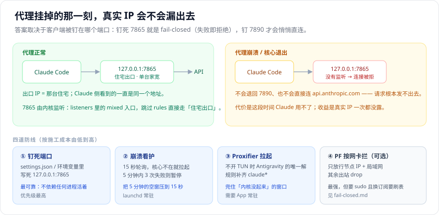

# 代理崩溃时的断网兜底（fail-closed）

> ← [文档索引](README.md) · [仓库首页](../README.md) · 相关：[客户端接入](clients.md)、[流量怎么进内核](traffic-entry.md)

目标只有一个：**代理不可用时，Claude.app 与 claude-code 宁可连不上，也不要直连真实 IP。**

这里讨论的是「出口消失」而不是「分流出错」——规则写得再对，只要进程绕过代理，规则层就管不到。

---



## 1. 两种失败方向

| 形态 | 触发 | 后果 |
| --- | --- | --- |
| **fail-open（危险）** | 系统代理被清空、应用回落直连、TUN 未接管 UDP | 真实出口 IP 直接暴露给对端 |
| **fail-closed（要的）** | 应用连不上 127.0.0.1:7865 就报错退出 | 只是用不了，不泄漏 |

实测结论（本机 2026-11-26）：**崩溃反而比正常退出安全。**
崩溃时 Clash Party 来不及清系统代理，设置仍指向死端口 → 应用连不上；
正常退出会把系统代理清掉 → 应用回落直连，那才是真正的泄漏窗口。

---

## 2. 现状取证（别再靠猜）

2026-11-26 22:10 那次断开，内核日志给出了精确边界：

```
22:10:14.938  level=warning  Mihomo shutting down
22:15:32.246  level=info     Start initial configuration in progress
```

停机 **318 秒**，期间 7865 / 7890 都没有监听。同期核查：

| 检查项 | 结果 |
| --- | --- |
| `~/.claude/settings.json` | `HTTPS_PROXY` / `HTTP_PROXY` 钉死 `http://127.0.0.1:7865`，`NO_PROXY=localhost,127.0.0.1` |
| 该窗口内的 claude 会话 | 0 条 API 记录（那个 `.jsonl` 的 mtime 是被 touch 的，内容止于 21:24） |
| 死端口实测 | 代理指向 `127.0.0.1:59999`、目标也改 `127.0.0.1:59998` → `rc=124` 超时挂起，公网连接 0 |
| Claude.app 内部二进制 | 9 个 Mach-O 全在 `Contents/Helpers/`，4 个 Helper 在 `Contents/Frameworks/` |

结论：**这次没有泄漏**。原因是 claude-code 的代理是钉死的，端口一死就失败，不会 fallback 直连。

---

## 3. 三层防线（由强到弱）

### 第一层：把代理钉进应用配置（最可靠）

```json
// ~/.claude/settings.json
{ "env": { "HTTPS_PROXY": "http://127.0.0.1:7865", "HTTP_PROXY": "http://127.0.0.1:7865" } }
```

优点：不依赖任何外部进程、不依赖 Clash Party 是否活着、重启后自动生效。
缺点：只管 claude-code，管不到 GUI 应用（GUI 走系统代理，而系统代理会被客户端清掉）。

### 第二层：Clash Party 崩溃看护（把 5 分钟压到 15 秒）

脚本：`~/.local/bin/clash-party-watchdog.sh`，由 launchd 每 15 秒跑一次。

判定逻辑（几种情况的区别就是这个文件的全部价值）：

| 现场 | 动作 |
| --- | --- |
| 进程在跑 | 什么都不做 |
| 进程不在 + 系统代理已关 | 视为用户主动 Cmd+Q，**不拉起** |
| 进程不在 + 系统代理仍开着 | 判定为崩溃（来不及清理），拉起 |
| 5 分钟内已拉起 3 次 | 判定崩溃循环，写 `pause` 标记后停手 |

```bash
# 安装位置
~/Library/LaunchAgents/local.clash-party-watchdog.plist   # StartInterval 15 / RunAtLoad
~/.local/bin/clash-party-watchdog.sh

# 手动暂停 / 恢复（想彻底退出代理时用）
touch  "$HOME/Library/Application Support/clash-party-watchdog/pause"
rm -f  "$HOME/Library/Application Support/clash-party-watchdog/pause"

# 看它干了什么
tail -f /tmp/clash-party-watchdog.log
```

只用「系统代理是否还开着」来区分崩溃与主动退出，是因为崩溃路径不会走到清理逻辑。
副作用要接受：手工 `pkill` Clash Party 会被判为崩溃并拉起；真要停就写 `pause` 标记。

> 用 `launchctl bootstrap gui/501 ...` 注册。若当前 shell 起不来（本机会报
> `Bootstrap failed: 5: Input/output error`），把同一行贴进 Terminal.app 执行，
> 或直接注销重登——登录时 launchd 会自动加载 `~/Library/LaunchAgents/` 下全部 plist。

### 第三层：Proxifier 自动拉起 + CLI 规则

规则文件：`~/Library/Containers/com.initex.proxifier.v3.macos/Data/Profiles/vibecoding.ppx`

```
ProxyList  : 109 = HTTPS 127.0.0.1:7865
ChainList  : 108 = Clash-Static → 109
RuleList   : Claude / claude-code → Chain 108
             Applications: "Claude.app"; "Claude"; com.anthropic.claudefordesktop; claude*
             Default      → Direct
```

三点必须知道：

1. **改规则前先退出 Proxifier**，否则退出时会被内存里的旧配置覆盖。
   `osascript -e 'quit app "Proxifier"'` 可能被「自动化」权限拦住，直接用 `pkill -TERM -x Proxifier` 即可，
   改完确认文件 hash 未被重写。
2. **`claude*` 是必须的**：Proxifier 原来只写了 `Claude.app` / `Claude`，CLI 进程名是 `claude`，靠
   `settings.json` 才没漏。
3. **`Default = Direct` 是 fail-open**。改成 Block 会连带掐掉所有未列出进程的直连，不建议动；
   要真要 fail-closed，走下面第 4 节的 PF 方案。

自动拉起（它默认不在登录项里）：

```
~/Library/LaunchAgents/local.proxifier-autostart.plist   # /usr/bin/open -gj /Applications/Proxifier.app
```

---

## 4. 社区里更强的方案：PF 按网卡拦

社区（`Claude-Guardian` 等项目）的共识是：**macOS 上真正的 kill switch 只能做在 PF，且必须按网卡，不能按进程。**

原因：

- **LuLu 这类按进程过滤的防火墙做不了**。它的判断发生在路由之前，分不出一个连接是走 TUN 还是直连。
  只放行代理核心 → 正常经 TUN 的连接（比如 `curl` 连 1.1.1.1）也被按 `curl` 拦掉；
  反过来给每个应用放行 → TUN 一掉它们又直连。两头都不成立。
- **PF 可以做对**：物理网卡（`en0` 等）只放行「发往节点真实 IP:端口」+ DHCP + 必要的局域网例外，
  其余出站一律 drop；`utun` 与回环不受影响。核心或 TUN 一停，应用流量落回物理网卡 → 被丢 → 不直连。

要点（照抄社区踩坑结论）：

```bash
# 规则放独立 anchor，不改 /etc/pf.conf（Apple TN3165 明确 PF 不是稳定接口）
sudo pfctl -a com.apple.claude-guardian -f /path/to/killswitch.conf
```

- 节点要用**真实 IP**，不能是 fake-ip 段（`198.18.x.x`）；节点是域名时，要把核心的
  `proxy-server-nameserver` 一起放行，否则核心自己解析不出节点。
- 系统 DNS 要手动设成公网 IPv4：网络服务是「自动」时换网会拿到路由器地址，
  查询走物理网卡被 PF 丢掉，表现是「IP 能通、域名解析失败」（`curl` exit 6）。
- **必须先演练再宣称成功**：停核心，确认外网全失败、没有直连；恢复核心，确认出口一致。
  没演练只能说「规则已配置，未验证」。
- 保险丝：apply 时给个自动撤销的时限（社区脚本常见 180 秒），确认通了再固化。

代价（要提前接受）：代理一挂整机断网（含 macOS 更新、iCloud、其它 App）；
换网卡、新增网卡、客户端更新后都要重新 `apply`（节点 IP 变了不用，`sync` / `watch` 管够）。
所以它是**给固定出口场景用的**，不适合把代理当「随时可关」的人。

### 本仓库的脚本化实现（v2：节点 IP 放 table，不再写死）

`scripts/pf-killswitch.ts`（bun 运行，读 mihomo 运行时配置自动解析节点 IP）：

```bash
cd /path/to/easy_proxy_rules

bun scripts/pf-killswitch.ts render            # 只打印规则与要放行的 IP（不需要 sudo）
bun scripts/pf-killswitch.ts apply             # sudo pfctl -a <anchor> -f；默认 180 秒保险丝
bun scripts/pf-killswitch.ts confirm           # 演练通过 → 取消保险丝，固化
bun scripts/pf-killswitch.ts sync              # ★ 换订阅 / 换节点之后跑这条
bun scripts/pf-killswitch.ts watch             # ★ 常驻：配置一变就 sync，每 60 秒再全量重解析
bun scripts/pf-killswitch.ts suspend --for 180 # ★ 安全窗口：只放开订阅域名 80/443，其余照旧拦
bun scripts/pf-killswitch.ts suspend --for 60 --open   # 全开窗口（真实 IP 会暴露，慎用）
bun scripts/pf-killswitch.ts status            # anchor 规则 + table 内容
bun scripts/pf-killswitch.ts off               # 立刻撤销
bun scripts/pf-killswitch.ts install           # 生成 LaunchDaemon plist 与安装命令
```

设计要点：

- **anchor 独立**（默认 `com.apple.hpsrv.killswitch`），不碰 `/etc/pf.conf`，撤销只影响自己；table 也建在这个 anchor 里。
- **节点 IP 进 table，不进规则文本**：

  ```
  table <hs_nodes> persist { ... }
  pass out quick on { en0, … } inet to <hs_nodes> keep state
  ```

  换订阅后只需要 `pfctl -a <anchor> -t hs_nodes -T replace -f <ip列表>`，
  **规则不重载、anchor 不重建、没有空窗**。这就是 v1 最大的缺陷所在——见下面「换订阅会发生什么」。

- **刷新策略是「并集 + 宽限期」**：新解析到的 IP 立刻进 table；上一轮见过、这轮没解析出来的 IP，
  只要 10 分钟内出现过就继续放行（`--grace`），超过就清掉。订阅刚切换、核心还在重连的那几十秒里，
  新旧 IP 同时在放行名单上，不会两头都断。
- **解析 0 个 IP 时拒绝改写 table**，宁可保持旧状态，也不会把自己锁死。
- **watch 只刷 table，不会把规则加回来**：`off` 之后它进「等待规则重新加载」状态，
  每 60 秒探一次，你自己再 `apply` 它就跟上；不存在「撤销了又被守护进程复活」。
- **规则只挂在物理网卡上**（默认路由那张 + 所有配了 IPv4 的 `en*`），pass 和 block 都带 `on { en0, … }`。
  不能写成不限网卡的 `block out quick all`——TUN 的流量是从 `utunN` 出去的，那条兜底 block 会把 TUN 自己的包也丢掉，
  表现是「一 apply 整机没网」。**这也是 v1 埋的雷**：`pfctl -n -f` 语法通过，但从没真跑过，所以没暴露。
- **放行清单**：`lo0`（回环）、本机所在网段（自动从 `ifconfig` 算）、`224.0.0.0/4`（mDNS）、
  DHCP `68→67`、`223.5.5.5` / `119.29.29.29:53`（核心启动时解析节点域名用）、table 里的全部节点 IP，
  最后一条 `block out quick on <网卡> inet all` 就是 fail-closed 本身。utun 不在任何一条规则里 → 不受影响。
- **保险丝**：`apply` 在同一个 sudo 里 fork `sleep 180 && pfctl -F all`，超时自动撤销；
  演练通过后 `confirm` 杀掉它。避免「规则写错 + 没人能 SSH」的死局。
- **表内容永远以本次解析为准**：`pfctl -f` 遇到 `table { … }` 是「往里加」不是「替换」，
  所以 `apply` 之后还会显式 `-T replace` 两张表（订阅表没有内容时 `-T flush`）。
  不这么做的话，换掉的旧订阅 IP 会一直留在表里被放行。
- 状态文件在 `/tmp`：宽限期跟着重启/清理一起丢，表现是「重启后旧节点 IP 立刻不再放行」。
  这只影响切换时的平滑度，不影响安全性。
- **订阅域名默认不放行**：`profile.yaml` 里的订阅地址不是节点，PF 生效后「直连拉订阅」会被自己的规则丢掉，
  表现是订阅永远停在旧节点列表、客户端还不报错。两条路：`suspend`（一次性，只放开订阅域名）；
  或者 `apply --subscribe-hosts`，把订阅域名解析出的 IP 放进独立的 `hs_nodes_subs` 表、**只放行 80/443**。
  默认关掉是因为订阅站大多挂了 Cloudflare，共用 IP 上任何 https 站点都会被连带放开——这个口子宁可手动开。
- 只处理 IPv4。IPv6 节点会打警告（当前订阅全是 IPv4）。

### 换订阅 / 换节点会发生什么

这是 v1 的真实事故面：规则里存的是**当时的** IP，订阅一换，新节点全被自己的规则丢掉，
表现是「整个网络挂了，但 ping 得通网关」，不看 `/tmp/pf-killswitch.conf` 根本想不到是它。

| 场景 | 不装 watch（只有 apply） | 装 watch（推荐） |
| --- | --- | --- |
| 同一订阅自动更新，节点 IP 变了 | 新节点连不上，旧 IP 还在表里 → 走旧节点或直接断 | 配置 mtime 一变，3 秒内补进 table；旧 IP 再保 10 分钟。**但订阅本身拉不下来**，见下两行 |
| 切到**已下载**的另一份订阅 | 断网，要手动 `sync` | 不用管。表 3 秒内跟上，旧 IP 宽限 10 分钟；核心重启那几秒丢包，但不漏（fail-closed 兜住） |
| 从 URL **更新 / 新增**订阅 | 订阅拉不下来（除非 `--subscribe-hosts`） | 一样拉不下来 → 用下面的 `suspend` 安全窗口 |
| 节点域名换了 A 记录 | 同上，直到重新 apply | 每 60 秒全量重解析，自动跟上 |
| 换网卡（Wi‑Fi ↔ 有线） | 局域网网段放行失效 | 仍需 `apply` 一次（网卡名/网段写在规则里） |
| 换客户端（数据目录变了） | 配置文件路径变了，解析不到 | `--config` 指到对方的 `work/config.yaml` |

**切已下载的订阅不需要 suspend**。这一条容易做多：表是动态的，新节点 IP 3 秒内就进表了，
中间那几秒掉线是「连不上」而不是「直连出去」。

只有**要从 URL 拉取**时才需要开窗口，顺序如下：

```bash
# 新订阅域名已经在 profile.yaml 里（更新已有订阅）
sudo bun scripts/pf-killswitch.ts suspend --for 180
# 在客户端里更新订阅、挑个节点连上
sudo bun scripts/pf-killswitch.ts sync      # watch 在跑就等 3 秒，它自己刷
sudo bun scripts/pf-killswitch.ts status    # 确认 subs 表已清空、规则回到拦截状态

# 首次添加订阅：域名还没写进 profile.yaml，脚本猜不到，手动给
sudo bun scripts/pf-killswitch.ts suspend --for 180 --host sub.example.com
```

> `suspend` 默认**不是全开**：它只把订阅域名的 80/443 放开，其余出站继续 drop，窗口结束自动恢复
> （不用 `confirm`）。真需要完全放开（比如换网卡后跑诊断）才加 `--open`——那段时间没有 kill switch。

### 装成守护进程（换订阅自动跟）

```bash
bun scripts/pf-killswitch.ts install
# 按打印出来的三条命令执行（要 root：watch 得有权限改 table）
sudo cp /tmp/local.hpsrv.pf-killswitch.plist /Library/LaunchDaemons/
sudo launchctl bootstrap system /Library/LaunchDaemons/local.hpsrv.pf-killswitch.plist
tail -f /var/log/hpsrv-pf-killswitch.log
```

顺序不能反：**先 `apply` + `confirm` 把规则立住，再装守护**。守护只负责刷 table，
规则不在时它会打一行 `anchor 未加载，等待规则重新加载` 然后每分钟再探一次，不会凭空造规则。

卸载：`sudo launchctl bootout system/local.hpsrv.pf-killswitch`。

实测（本机 2026-11-26）：`render` 从 35 个节点解析出 **32 个去重 IPv4**，覆盖 oh-node 全线路
（jp/sg/hk/tw/kr/us/uk/nl/de/my）+ 两台住宅（JP、US 各一台，地址打码）+ 丽萨 `192.220.x.x`；
生成的规则通过 `pfctl -n -f` 语法解析（rc=0），table 合并逻辑用假状态验证过
（30 分钟前的 IP 保留、4 小时前的清掉、解不出的域名只告警不中断）。
换订阅也模拟过一次：旧表里留着 `1.1.1.1 / 2.2.2.2`，换成含 `3.3.3.3 / 4.4.4.4 / 5.5.5.5` 的新配置后
`render` 输出「新增 3 / 宽限保留 2 / 清理 0」，表里 5 条 —— 新旧并存，所以切换瞬间不会两头断。
订阅表另外试了一次：`--subscribe-hosts` 下 19 个订阅域名解出 32 个 IPv4，几乎全是 Cloudflare 段
（`104.21.x` / `172.67.x`）——共用 IP 上任何 https 站点都会被连带放开，所以默认关。

> ⚠️ `apply` / `confirm` / `off` / `sync` / `suspend` 需要 sudo。本机 agent 沙箱里 `sudo` 被直接拒绝
> （`operation not permitted: sudo`），所以**下发这一步必须你自己在 Terminal.app 里执行**。
> 上面几条命令原样粘贴即可。


---

## 5. 换客户端的取舍

本机跑的是 Clash Party（Electron）。如果崩溃是常态，按稳定性排序：

| 客户端 | 形态 | 备注 |
| --- | --- | --- |
| **裸 mihomo 核 + LaunchDaemon** | 无 GUI | 最稳。崩溃面最小，用 Zashboard 之类的网页面板管理；代价是改配置靠文件 |
| **FlClash** | Flutter | 多端一致、状态栏切换节点比 Verge 顺手 |
| **Clash Verge Rev** | Tauri | 功能最全，但 2.x 的「服务模式 + TUN」有过引发 macOS 内核 panic（watchdog timeout）的实际案例，重 TUN 用户要留意 |
| Clash Party（现状） | Electron | 覆写/脚本能力强，正好是本仓库 `smart.js` 依赖的能力；崩溃多与 Electron 层和 TUN 交互有关 |

判断口径：**只要还用 `smart.js` 这类脚本覆写，可选面就只剩 Clash Party / FlClash / Verge 这类支持覆写脚本的客户端。**
裸核方案要把 `smart.js` 的产物烤成静态 YAML 定时更新，属于另一条维护路线。
同门分支（从 Clash Party 分出去的其它 Mihomo GUI）脚本层基本同源，换过去**稳定性不会变好**——
它们同样跑 Electron + TUN，崩溃面是同一套，不值得为此迁移。

真要换 FlClash，先看实测：[Clash Party vs FlClash](clash-party-vs-flclash.md)——
配置能过内核校验，但 7865 住宅口、路径正则进程规则、窄 TUN 三样会丢。

---

## 6. 验收清单

```bash
# 1. 三层防线就位
grep -c 7865 ~/.claude/settings.json                    # >= 2
launchctl print gui/501/local.clash-party-watchdog | head -3
ls -l ~/Library/LaunchAgents/local.proxifier-autostart.plist
pgrep -x Proxifier

# 2. 看护脚本不会误伤（DRY 模式，不真的拉起）
STATE=/tmp/wd-dry PROC=NoSuchProc DRY=1 sh ~/.local/bin/clash-party-watchdog.sh; cat /tmp/clash-party-watchdog.log

# 3. PF 规则（若启用）
sudo bun scripts/pf-killswitch.ts status                     # table 条数应≈节点数，不是 0
sudo pfctl -a com.apple.hpsrv.killswitch -sr | grep -c "on en"  # 每条 pass/block 都该带网卡
sudo pfctl -a com.apple.hpsrv.killswitch -sr | tail -2        # 最后一条应是 block out quick on … inet all

# 4. 断网演练（只在能接受短暂断网时做）
#    停核心 → 浏览器/curl 全部失败且没有直连 → 15 秒内自动恢复 → 出口 IP 与之前一致
```

真正要验证的是第 3 步：**规则存在 ≠ 保护生效**。
